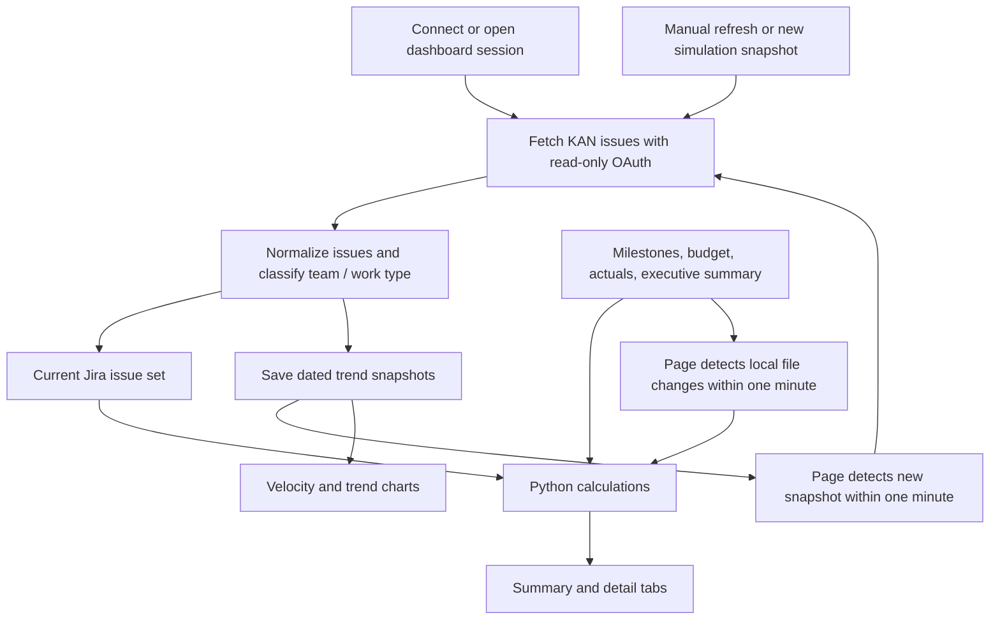
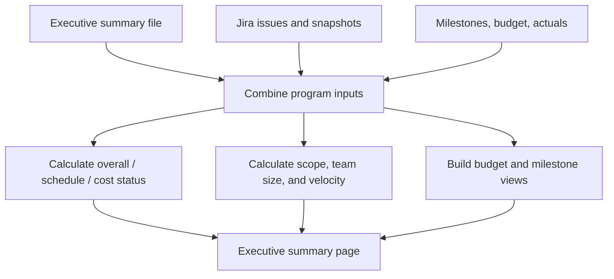
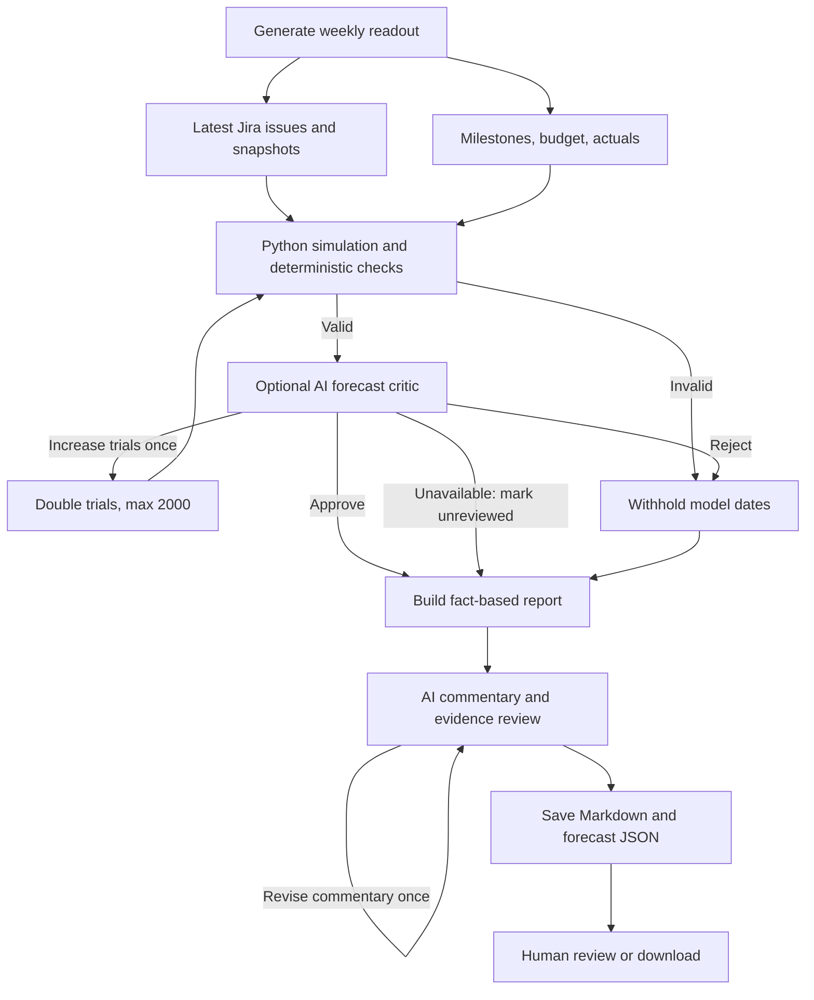
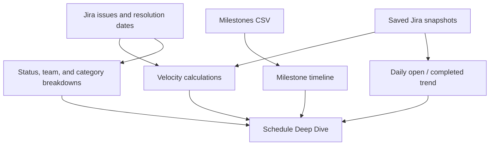
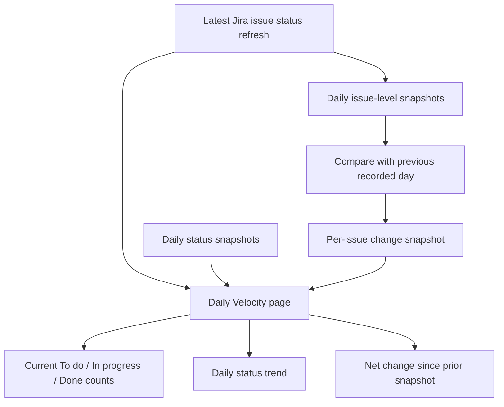
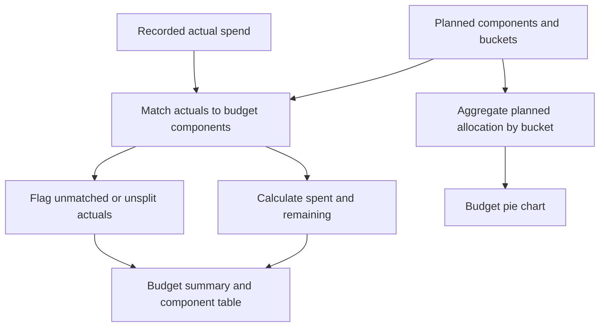
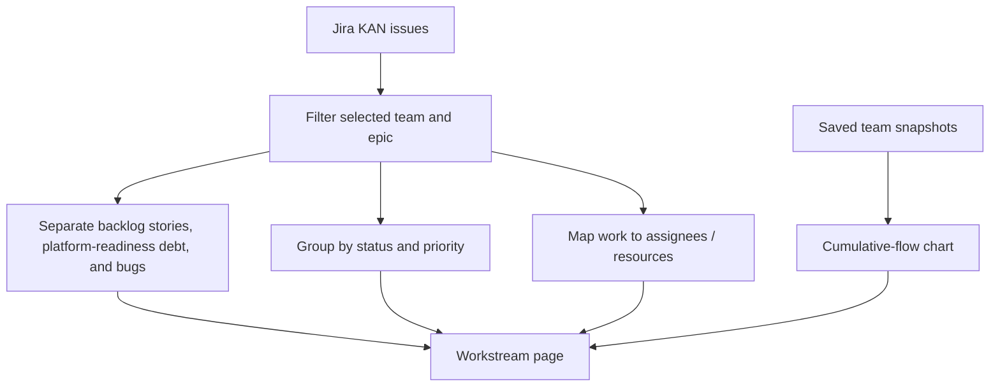
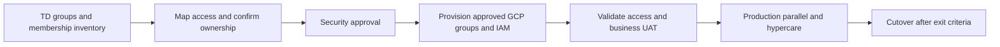
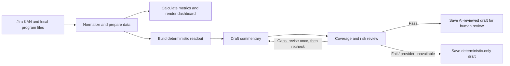
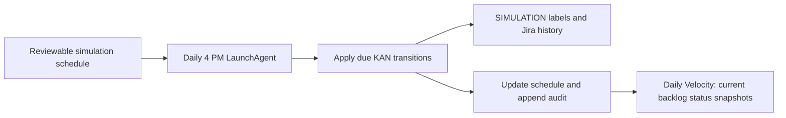

# TeamVishAI Jira Program Dashboard

A local, read-only Streamlit dashboard for Jira project `KAN`. It includes the executive summary, milestone timeline, Jira portfolio charts, and Finance & Accounting, Credit, and Collections views.

The program summary includes a daily trend chart for open and completed Jira stories and bugs. The independent daily simulation job and each **Refresh from Jira** save daily count snapshots in `data/weekly_work_snapshots.csv` and issue-level snapshots in `data/daily_issue_status_snapshots.csv`, replacing that day's point with the latest data. The generated snapshots are excluded from source control.

The executive page also shows a proposed $10 million USD Phase 2 migration budget: $4 million for the implementation partner SOW through closure and hypercare, $4 million for 13 in-house resources, $1 million for compute/platform/support, and $1 million in contingency. Edit `program_budget.csv` to revise allocations or coverage.

The milestone chart is a phase timeline spanning September 20, 2026 through October 31, 2027. Phase start and end dates are maintained in `milestones.csv`.

## Run locally

Use Python 3.10 or later from this folder:

```bash
python3 -m venv .venv
source .venv/bin/activate
python -m pip install -r requirements.txt
streamlit run app.py
```

The executive summary and milestone timeline work without Jira credentials. Jira cards and charts remain empty until the OAuth connection is configured and refreshed.

## Local Llama commentary with Ollama

The local evidence reviewer uses schema-constrained JSON, a deterministic generation setting, and an explicit 8K context window. It lists evidence gaps before making its approval decision; absent monthly plans are not treated as missing spending variances. Python independently checks exact status values and financial amounts, even when the model approves. Status checks accept explicit equivalent wording (for example, “Overall status is RED”) while rejecting contradictory values. Commentary is constrained to a status line, short summary, and one to five bullets; extra section headings or Markdown tables fail deterministic checks to prevent duplicated report sections. Unsupported-claim findings are discarded only when they are literal sentence-sized quotes present in both the source report and draft; other evidence and coverage findings still apply. This is a bounded evidence check, not a guarantee that every narrative claim is correct; human review is still required. Truncated responses and unresolved evidence failures still keep the fact-based report.

Weekly readout commentary uses Ollama locally by default. Install and open Ollama, then run `ollama run llama3.2` once to download the model. Keep Ollama running while generating a readout in Streamlit. The scheduled readout job also needs Ollama running on this Mac when the job runs.

### Model and provider details

| Setting | Default behavior |
|---|---|
| Provider | Ollama, running on this Mac |
| Model | `llama3.2`, Ollama's default 3B instruction-tuned text model; the current Ollama listing is about 2 GB. See the [Ollama model page](https://ollama.com/library/llama3.2). |
| Local endpoint | `http://localhost:11434/api/chat` |
| Model's role | Reviews the Python forecast bundle, then separately drafts and reviews commentary with at most one commentary revision. Python owns metrics, status, dates, and Jira evidence. |
| Model input | The conditional forecast bundle for its critic; the fact-based readout, highlights/lowlights, actions, and evidence for commentary. |
| Forecast loop | Python → deterministic checks → optional critic → one permitted trial-count rerun → second review. AI cannot edit dates or assumptions. |
| Commentary loop | Structured status line, summary, and one to five bullets → critic → optional single revision → critic. Exact Python status values are preserved, and headings/tables are rejected. |
| Jira access | The dashboard connection remains read-only. The model does not create or update Jira issues. |
| If the model is unavailable | Valid Python forecasts remain unreviewed; the fact-based report is saved without commentary, with visible diagnostics and a scheduled-job log entry. |

The configured provider receives the Python forecast bundle for its critic and the report for commentary. Ollama keeps these calls local; selecting OpenAI sends that content to the OpenAI API. No OpenAI API key is needed for local Ollama.

To change the local model or Ollama URL, set `[ai]` in `.streamlit/secrets.toml`:

```toml
[ai]
provider = "ollama"
model = "llama3.2"
base_url = "http://localhost:11434"
```

To use OpenAI instead, set the provider and model, then add your API key:

```toml
[ai]
provider = "openai"
model = "gpt-6-luna"

[openai]
api_key = "YOUR_OPENAI_API_KEY"
```

Use `ollama list` to see the model tags installed locally. Never commit `.streamlit/secrets.toml`.

## How the dashboard works by tab

### Shared data flow

Authorize Jira once from the sidebar. On a new dashboard session, PT-app loads the current `KAN` issues automatically; **Refresh from Jira** remains available for on-demand updates. While the page is open, it checks Jira snapshot files and local program inputs every minute. A new snapshot from the independent simulation job triggers a fresh Jira fetch and rerender across dashboard pages. Changes to `milestones.csv`, `program_budget.csv`, `program_actuals.csv`, or `executive_summary.md` trigger a rerender so the dashboard rereads those files. Other direct Jira edits do not update the snapshot automatically; use **Refresh from Jira** to fetch them. Each successful Jira fetch normalizes and classifies issues and saves the daily trend snapshots.



### Program Summary

The executive summary combines the context in `executive_summary.md` with calculated program status, milestone timeline, Jira scope and team size, an open-versus-closed closure donut, and a one-line planned closure rate. Budget cards and cost status use `program_budget.csv` and `program_actuals.csv`. Detailed planned-versus-actual velocity remains in Schedule Deep Dive.

Under Schedule overview, a stacked chart shows status by priority for the current Stories and Bugs by item count. Beside it, the **Complexity/Effort view** pie groups Stories by their distinct story-point estimates, including completed Stories. Each slice counts Stories rather than summing points. Missing or invalid estimates appear in a **Not estimated** slice; zero is a valid estimate. Jira estimate fields are discovered by name during refresh. Refresh Jira after updating the app to load story points into an existing session.



### Weekly Readout

Choose **Generate weekly readout draft** to assemble a deterministic report from the latest Jira data, saved snapshots, milestones, budget, and actuals. The configured model runs a bounded draft-review-revise loop for commentary: a critic checks coverage of Overall/Schedule/Cost status, scope and trend, milestone and pace evidence, budget and variance, and the report's material lowlights and actions. If gaps are found, the model revises once and the critic checks again. If the commentary still fails or the model is unavailable, PT-app saves the fact-based report without AI commentary. Calculated metrics and Jira evidence remain deterministic. Drafts are saved under `data/weekly_readouts/` for human review or download. The readout loop is read-only and does not write to Jira or publish the report elsewhere.

The weekly readout keeps forecasting to a short **Unit testing forecast summary**: the earliest and latest modeled completion dates, brief assumptions, and a note directing readers to **Schedule Deep Dive** for the full forecast. The same compact summary appears in the Weekly Readout context preview. Per-workstream effort, completion history, scenario tables, trial fractions, readiness gates, and detailed diagnostics remain on Schedule Deep Dive or in the downloadable forecast JSON.

The summary uses the following user-confirmed KAN plan:

| Scenario detail | Confirmed plan |
| --- | --- |
| Data | Fully simulated KAN activity |
| Scope | All KAN Stories and Bugs, including technical debt |
| Completion criterion | At least 91% Done by item count, not story points |
| Planned deadline | April 30, 2027 — Unit testing validation |
| Accountable owner | TPM |
| Scope growth | New inventory may increase scope through the scenario cutoff of October 30, 2026 |

The current Jira backlog already includes the 100 Stories KAN-244 through KAN-343. Those Stories are part of current scope, not an additional future-growth assumption. Inventory remains open to further Story additions through October 30, 2026; their quantity and story-point mix are unknown. The required count for the 91% target and the item pace use currently loaded scope and remain provisional, excluding unquantified future arrivals.

Weekly reports explicitly call out the allowance of up to 9% unfinished work at the 91% target as a schedule risk, alongside current unfinished work and the actions needed to address it. The allowance is a scenario threshold, not the actual unfinished percentage or a probability. After October 30, the readout asks the TPM to confirm the inventory baseline; reaching the date does not automatically freeze scope.

If the primary simulated median falls after the planned deadline, the report explicitly adds a timing lowlight and a follow-up action. Calendar-derived milestone status remains separate from this conditional model risk.

The summary's earliest date is the earliest 10% model date across the configured growth and selection cases; its latest date is the latest 90% model date across those cases. This is an early-to-conservative modeled range, not a guaranteed first or last possible date. If any case cannot produce a 90% date within the horizon, the latest date stays unavailable rather than presenting a finite upper limit. April 30 remains the planned deadline. Brief assumptions cover the 91% item-count target, full remaining story-point effort, independent unchanged teams at 100% allocation, configured growth through October 30, and model-only assumptions for missing estimates; Done is final and later UAT/business closure is excluded.

Generating a weekly draft runs Python simulation and deterministic checks, then an optional AI forecast critic, before assembling the report and running the separate commentary review. At most one forecast rerun is allowed, doubling trials up to 2,000; the critic cannot edit dates or business assumptions. Rejected model dates are withheld while the fact-based report remains available. If the critic is unavailable, valid Python results remain explicitly unreviewed. The Markdown uses only the compact forecast summary; full replay inputs and diagnostics remain in each draft's `.forecast.json` companion, available through **Download forecast inputs and diagnostics**.



### Jira Delivery Simulation

Project `KAN` is fully simulated. The job schedules open Story and Bug issues through the configured forward workflow path, targeting at least 91% of all Stories and Bugs, including technical debt, in Done by April 30, 2027. This is an item-count target; story points do not determine its percentage. The TPM owns the scenario, and inventory can increase scope through October 30, 2026. The job records simulation labels and audit details for every applied Jira transition. Each daily run also saves program-wide, team-level, and issue-level trend snapshots, so the workstream cumulative-flow charts and Daily Velocity change list build without a manual Jira refresh. The schedule is reproducible and kept under the ignored `data/jira_simulation/` folder. The simulator is an independent daily LaunchAgent: it uses its own OAuth token, schedule, and audit log, and does not wait for or depend on the Friday weekly-readout job. The weekly-readout job only creates a report draft and does not update Jira. See [`jira_simulation_setup.md`](jira_simulation_setup.md) for OAuth setup, daily cadence, and pause instructions, and [`jira_simulation_job_plan.md`](jira_simulation_job_plan.md) for scope and behavior.

### Schedule Deep Dive

This tab expands the timeline and delivery measures: milestone phases, planned and actual velocity toward Unit Testing, Jira status and team charts, work category breakdown, and the daily open/completed work trend. The simulator and Jira refreshes add daily points.

Open work by priority and four trailing seven-day completion windows sit beside the existing required-versus-actual item pace. An effort-based milestone outlook shows known remaining Story/Bug points, estimate coverage, workstream detail, and completed points over the last four weeks. The **Unit testing forecast** panel shows conditional simulation dates, trial fractions, assumptions, capacity evidence, and review diagnostics. Ordinary page previews run cached Python and deterministic checks without calling AI; they are marked unreviewed. Weekly Readout shows only the earliest/latest modeled date summary and brief assumptions, with a note linking readers to this detailed page. Draft generation runs the forecast critic and saves the reviewed or explicitly unreviewed run. All cases use the confirmed 91% item-count target and April 30, 2027 deadline.



### Conditional simulated forecast

The enabled local KAN scenario has five owner declarations covering milestone scope, dependencies, capacity, remaining work, and testing/rework. They record the agreed demonstration assumptions; the app does not independently verify them. The shipped example keeps forecasting disabled and every confirmation false. The engine requires explicit simulation mode, valid scenario inputs, and those five declarations with evidence and owners. It does not enable real delivery forecasting.

| Model input or rule | Implemented behavior |
| --- | --- |
| Work and target | All current Stories/Bugs, including technical debt, counted once; required Done items are rounded up from 91% of each scenario's total |
| Remaining effort | Done is final for this stage; every not-Done item retains its full valid recorded story points, including items already in progress |
| Team capacity | Independent parallel workstreams, unchanged team size, and 100% program allocation; point scales stay within their workstreams |
| Weekly budget | Lognormal budget per workstream, centered on known points from currently Done items resolved in the last seven days |
| Missing capacity history | Explicit assumption of 8 relative points per assigned contributor per week; one contributor is assumed if no named assignee is available |
| Missing estimates | Open items receive their workstream's positive-estimate upper quartile only inside the model; source estimates and coverage remain unknown |
| Future arrivals | 0%, 10%, and 25% additional scope sensitivities while inventory is open; arrivals sample current workstream, priority, and effort mix through the cutoff |
| Selection policies | Priority first, then larger items first as the primary case; priority then smaller items first exposes residual-work sensitivity |
| Acceptance gate | No earlier than the observation date, the inventory-growth cutoff while open, or the Unit testing planned start, whichever is latest |

The 100 Stories KAN-244 through KAN-343 are already in current scope and are never added again as future growth. Further arrivals remain unquantified: 0%/10%/25% are sensitivity settings, not estimated demand. After the cutoff, modeled future additions are zero but the report still requires TPM confirmation of the final inventory baseline. The scenario growth cutoff is **October 30, 2026**; the current `milestones.csv` Inventory completion due date is **October 31, 2026**. The alignment note is visible for review and does not silently change either date or block the simulated run.

Each case reports 10%, 50%, and 90% model dates and the fraction of all trials reaching the item-count target by April 30. Trials unfinished at the model horizon remain in the denominator; a percentile with too few finishes shows **Beyond horizon / unavailable**. These are outcomes conditional on the stated assumptions, not calibrated confidence or real delivery probabilities. The allowed unfinished portion remains a weekly schedule risk. Business UAT, acceptance sign-off, and overall program closure are separate downstream stages.

The optional `forecast` object in `data/estimation_inputs.json` supports only the following settings. Missing settings use defaults; invalid settings fail closed.

| Setting | Default | Allowed values |
| --- | --- | --- |
| `enabled` | `false` | JSON boolean |
| `seed` | `20261011` | Integer 0–4,294,967,295 |
| `trials` | `400` per case | Integer 100–2,000 |
| `horizon_weeks` | `156` | Integer 26–260 |
| `growth_fractions` | `[0, 0.10, 0.25]` | 1–5 distinct finite numbers in [0, 1], including 0 |
| `weekly_capacity_cv` | `0.35` | Finite number in [0, 1]; an assumed variation level |
| `fallback_points_per_person_week` | `8` | Finite number greater than 0 and at most 100 |

The horizon must also extend through the planned milestone deadline. A numerically valid horizon that ends earlier makes the forecast unavailable with a request to extend it.

The bounded review runs Python, deterministic scope/schema/date checks, then an optional AI critic. The critic may approve, reject, or request one recomputation with double the trials, capped at 2,000. It cannot change source facts, thresholds, growth cases, assumptions, seed, or dates. A second rejection or deterministic failure withholds model results. Reviewer unavailability preserves valid Python outputs labeled unreviewed. Commentary then has its own separate evidence review and one-revision limit. See [`weekly_readout_setup.md`](weekly_readout_setup.md) for saved artifacts and replay instructions.

### Real-delivery estimation readiness

Schedule Deep Dive separately assesses ten inputs for real delivery estimation. Its tables identify available evidence, blockers, an owner or role, and the next action; these detailed gates are omitted from the weekly summary. **Ready for model setup** means no assessed blockers remain; the assessment itself provides no date or confidence level. Simulated forecast availability does not satisfy these real-data gates. KAN remains blocked for real delivery estimation because its provenance is simulated, even when its demonstration model and evidence review succeed.

| Input | Evidence needed | Owner or role |
| --- | --- | --- |
| Scope and milestone target | Loaded Story/Bug scope and one explicit milestone deadline | TPM and milestone owner |
| Story-point estimate coverage | Usable estimates for every open item; unknown remaining in-progress effort stays separate | Story owners and workstream leads |
| Completion timing and representative history | Representative completion evidence with usable dates and recent estimates | TPM and workstream leads |
| Data provenance | Explicit real-data configuration and no observed simulation markers | Data owner and TPM |
| Milestone scope and acceptance | Jira work mapped to the milestone and clear acceptance criteria | TPM and testing lead |
| Dependencies | Sequencing, external dependencies, and blockers reviewed | Workstream leads |
| Capacity and leave | Available people, working time, and planned absences reviewed | Engineering managers |
| Active remaining work | Remaining effort for work already in progress reviewed | Story owners and workstream leads |
| Testing and rework | Validation, defects, and likely rework included | Testing lead |
| Model validation plan | A documented backtest and calibration plan with a named owner for the future model | Estimation model owner |

The history gate requires usable Done resolution evidence reaching at least 28 days back, positive estimated completions in the last 28 days, and an owner confirmation that the history is representative. That floor is a readiness check, not proof of forecast accuracy. Current estimate and completion-date gaps remain visible. KAN defaults to **simulation** because this app runs a daily simulator; other projects default to **unknown**. Jira simulation labels block readiness even if a local file declares the data real.

To supply owner declarations, copy [`estimation_inputs.example.json`](estimation_inputs.example.json) to `data/estimation_inputs.json`. The optional runtime file is ignored by Git. Set `project_key` to the exact current Jira project, choose `data_mode` from `simulation`, `real`, or `unknown`, and retain the `confirmations` object. The optional `milestone_scenario` object records `target_completion_pct` and `scope_growth_until`; the confirmed KAN values are `91` and `2026-10-30`. These scenario settings describe a plan and do not confirm estimation readiness.

Allowed confirmation keys are `milestone_scope`, `dependencies`, `capacity`, `remaining_work`, `testing_rework`, `history_representative`, and `model_validation`. Every supplied confirmation requires `confirmed` as a JSON boolean plus `evidence` and `owner` as strings. The five local KAN scenario declarations document the approved simulated scope, independent unchanged teams, full remaining effort, and separation of later UAT/business closure. The `history_representative` and `model_validation` inputs remain independent requirements for a real model. Validation evidence should describe a backtest and calibration plan with an owner; confirming a plan does not establish measured model accuracy. The app does not independently verify declarations, and simulation confirmations never make its history real.

A missing file leaves those declarations unconfirmed. Invalid JSON, unknown keys, wrong types, or a project mismatch discard all file declarations, restore the project defaults, and display an error. A valid `data_mode` alone cannot establish readiness.

### Daily Velocity

The current priority/pace panel summarizes open work by priority and weekly completion counts. The selected-day change section also exposes priority changes separately, including priority changes on items whose status moved on the same day.

This tab shows the current KAN Story and Bug counts in To do, In progress, Done, and Other, plus daily status snapshots and a per-issue change list comparing each saved day with its preceding snapshot. The list includes status movements, new or missing issues, and updates to team, assignee, priority, type, or summary. The default trend window is the last 10 calendar days; dates without recorded snapshots appear as gaps. Status counts are actor-neutral: they reflect Jira state regardless of who made the update. Current counts use the latest Jira refresh or saved daily snapshot. Issue-level history starts with the first snapshot after this feature is enabled; older count snapshots cannot identify which Jira items changed. The trend uses daily team snapshots when their combined scope matches the overall Jira Story/Bug count.



### Budget Breakdown

This tab compares planned allocations in `program_budget.csv` with actuals in `program_actuals.csv`, summarizes spent and remaining amounts, shows component-level mapping gaps, and charts planned allocation by broader budget bucket. Actuals that cannot be matched to a planned component remain visible as unmapped or unsplit.

A compact delivery context shows open High/Highest items, overdue high-priority items, and completions in the latest seven-day window. These are program-level delivery facts; they do not determine recorded spend or cost variance. Detailed priority and pace charts remain on Schedule Deep Dive.



### Finance & Accounting, Credit, and Collections

Each workstream tab filters Jira work to its configured epic and team. It shows backlog stories, platform-readiness technical-debt stories, and bugs, then breaks work down by status, priority, and assignee/resource. The cumulative-flow chart uses saved daily team snapshots; the daily simulator and successful Jira refreshes build its trend.

Each page also has open-work priority and weekly completion views plus a linked list of high-priority open issues. Both calculations use that page's scope, including its epic-linked technical debt. Completion counts use current page membership and Jira resolution dates, rather than historical team ownership at completion. A reliable team milestone finish estimate requires mapped milestone scope, dependencies, acceptance criteria, and sufficient estimate and delivery history.

Across detailed pages, weekly completion charts count currently Done Stories/Bugs in consecutive trailing seven-day windows ending at the last successful Jira refresh. These charts measure items, while the separate milestone outlook reports estimated effort in points. Unavailable resolution dates are shown as unavailable; a known window with no completions shows zero. Partial completion-date coverage is disclosed. High priority means Jira High or Highest; overdue means an open item's due date is before the Pacific date of the refresh. Program Summary keeps its status-by-priority item-count chart and Complexity/Effort pie under Schedule overview.



The team/epic filters are Finance & Accounting (`finance_accounting`, `KAN-6`), Credit (`credit`, `KAN-8`), and Collections (`collection`, `KAN-7`).

### Architecture

The Architecture page shows shared sources feeding dashboard pages and the independent refresh, weekly readout, and daily simulation workflows. Its delivery reference explains priority, completion counts, effort evidence, the conditional simulation and bounded critic, and the separate requirements for real delivery estimation.





The KAN simulation is a separate write path. It uses its own OAuth app, labels simulator changes in Jira, and its daily run records a Jira status snapshot. Daily Velocity reports the resulting backlog state without attributing changes to the simulator or a person.



## Jira OAuth setup

The Jira connection used in ChatGPT is separate from this standalone local app. For project data, an Atlassian administrator must provide a registered OAuth 2.0 (3LO) integration for the organization. The Streamlit dashboard requests `read:jira-work` and `offline_access` only. The simulator uses a dedicated OAuth app with `read:jira-work`, `write:jira-work`, and `offline_access`, configured with its own callback; setup is documented in [`jira_simulation_setup.md`](jira_simulation_setup.md).

1. Copy `.streamlit/secrets.toml.example` to `.streamlit/secrets.toml`.
2. Add the OAuth client ID and secret supplied by the Atlassian administrator.
3. Configure the same callback URL in the registered integration as `redirect_uri` (default: `http://localhost:8501/`).
4. Restart the app and choose **Connect to Jira** in the sidebar.
5. Authorize the TeamVishAI Jira site. PT-app loads KAN automatically; use **Refresh from Jira** for an on-demand update.

Never commit `.streamlit/secrets.toml` or paste the client secret into chat. The app saves OAuth tokens in `data/jira_oauth_token.json` so the connection can be restored after a Streamlit rerun or restart. The `data/` directory is excluded from source control, and the token file is restricted to the current user on macOS/Linux. Use **Disconnect** in the sidebar to remove the saved token.

## Dashboard data rules

- Project: TeamVishAI, key `KAN`.
- Epic pages: Finance & Accounting `KAN-6`, Collection `KAN-7`, Credit `KAN-8`.
- Team custom field: `customfield_10001`.
- Stories assigned to `finance_accounting`, `credit`, or `collection` count as backlog stories.
- Stories assigned to `platform readiness` count as technical-debt stories; they are grouped under their parent team epic in team pages.
- Bugs are counted by Jira issue type `Bug` and grouped under their parent team epic.
- Milestones and executive summary are read from `milestones.csv` and `executive_summary.md`.

The dashboard reads issues visible to the connected Jira account. Refresh the data in the sidebar to get the latest Jira statuses and counts.
