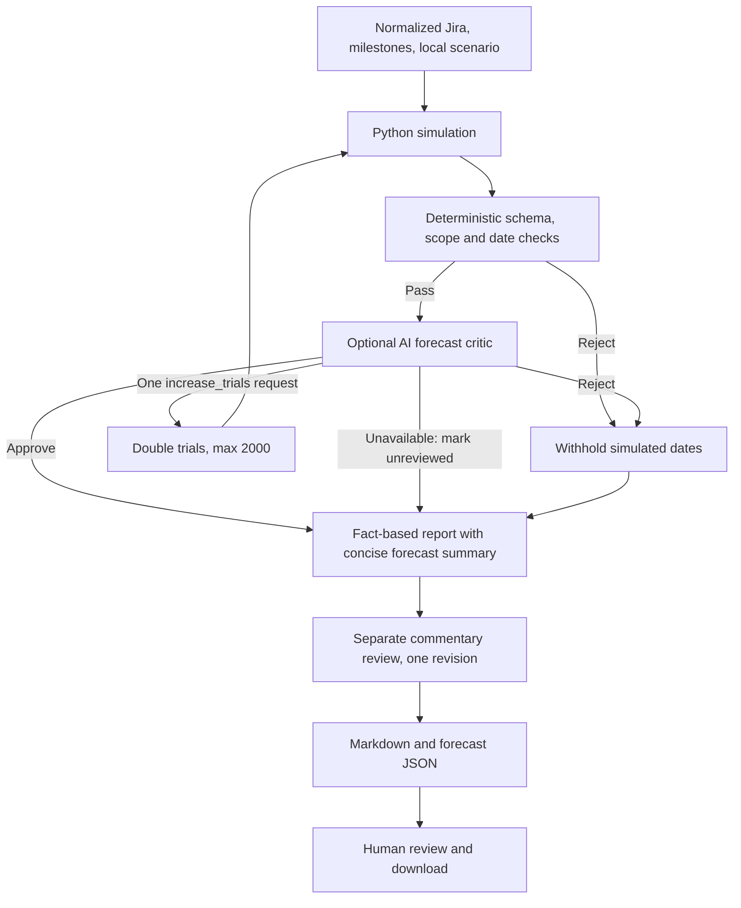

# Jira Program Dashboard — Implementation and Estimation Plan

## Purpose and current status

PT-app is an implemented local Streamlit dashboard for the transformation program. Python and Plotly combine Jira execution data with milestone, budget, actuals, and program context files. The dashboard and weekly readout use read-only Jira access. A separate, explicitly simulated daily job is the Jira write path.

The app now includes conditional simulated Unit testing estimation, deterministic output checks, optional bounded AI forecast review, and a separate executive-commentary review. Real-delivery estimation readiness remains an independent assessment; simulated history does not satisfy it.

## Implemented pages

| Page | Current behavior |
| --- | --- |
| Program Summary | Executive status, highlights/lowlights, milestone timeline, scope, team context, and budget. Schedule overview contains status by priority as item counts and a Complexity/Effort pie counting Stories by estimate, including a Not estimated slice. |
| Schedule Deep Dive | Milestone detail, required/observed item pace, priority action links, weekly item and effort evidence, conditional Unit testing scenarios, model diagnostics, real readiness, and daily trends. |
| Budget Breakdown | Planned allocations, recorded actuals, remaining amounts, comparable variance, and compact delivery context. Jira progress does not determine spend. |
| Finance & Accounting | Epic/team-filtered backlog, technical debt, bugs, status, priorities, weekly completions, assignee workload, and cumulative flow. |
| Credit | The same delivery views for the Credit epic and team. |
| Collections | The same delivery views for the Collections epic and team. |
| Architecture | Shared-source diagrams, independent automation workflows, and delivery/estimation definitions. |
| Other Reports | Weekly Readout with a compact earliest/latest forecast summary, brief assumptions, saved Markdown/forecast JSON downloads, and Daily Velocity with snapshot trends and net issue changes. |

## Sources and access

Jira Cloud OAuth 2.0 (3LO), token refresh, accessible-site selection, paginated issue retrieval, and normalization are implemented. The app uses the connected user's read permissions. Local settings and token caches remain outside source control; the ChatGPT Jira connection is separate from this app's OAuth setup. **Refresh from Jira** and the detected output of the daily simulator update dashboard evidence.

Milestone phases come from `milestones.csv`; budgets and recorded actuals come from their CSV files. The program cap is $10 million, and current allocation/actual values are read from those sources rather than inferred from Jira. `executive_summary.md` supplies program context. Daily aggregate, team-flow, and issue-level snapshots support trends and net comparisons; they do not reconstruct every Jira event.

| Team | Team field / epic | Jira issue |
| --- | --- | --- |
| Finance & Accounting | `finance_accounting` / `KAN-6` | [KAN-6](https://vishala-ai.atlassian.net/browse/KAN-6) |
| Collections | `collection` / `KAN-7` | [KAN-7](https://vishala-ai.atlassian.net/browse/KAN-7) |
| Credit | `credit` / `KAN-8` | [KAN-8](https://vishala-ai.atlassian.net/browse/KAN-8) |

The Jira Team field (`customfield_10001`) drives grouping. `platform readiness` identifies technical debt, and team pages include that work when linked to their epic. Jira status categories supply To do/In progress/Done; original statuses remain in issue tables. Stories and Bugs are the milestone denominator; Epics, Tasks, and subtasks are excluded.

## Confirmed KAN scenario and plan dates

| Decision | Recorded assumption |
| --- | --- |
| Provenance | Fully simulated KAN activity |
| Scope | All KAN Stories/Bugs, including technical debt |
| Unit testing criterion | At least 91% Done by item count, rounded up to whole items |
| Planned deadline | April 30, 2027; planned Unit testing start is February 1, 2027 |
| Accountable owner | TPM |
| Unfinished allowance | Up to 9% at the target must remain an explicit weekly schedule risk; it is not an actual residual percentage or probability |
| Inventory arrivals | Further additions may occur through the scenario cutoff of October 30, 2026; quantity and point mix remain unknown |
| Existing additions | KAN-244 through KAN-343 are the 100 Stories already in current Jira scope and must not be added again as future growth |
| Final baseline | TPM confirmation is required after the growth cutoff; the date alone does not verify scope closure |

The current CSV Inventory completion milestone is due **October 31, 2026**, while the scenario's growth cutoff is **October 30**. The visible, nonblocking alignment note preserves both inputs for review. Remaining planned phase deadlines are Conversion and overall analysis — March 31, 2027; Business UAT validation — June 30; Overall prod parallel — August 31; Overall closure and the cutover — October 31, 2027. `milestones.csv` remains the schedule source.

Required item counts and pace shown for current scope exclude unquantified future arrivals and remain provisional. Forecast growth cases explore that uncertainty rather than assert likely additions. Done is final for this modeled stage; Business UAT, acceptance sign-off, and overall program closure are separate.

## Implemented estimation method

The model samples weekly effort budgets and whole-item completion within each workstream. It does not divide the item count or pooled story points by a single velocity to produce a finish date.

| Element | Implementation |
| --- | --- |
| Workstream capacity | Independent parallel queues; unchanged team size and 100% program allocation; point scales remain local to each workstream |
| Remaining effort | Every not-Done item retains its full valid estimate, including work in progress; Done has zero remaining effort |
| Capacity evidence | Lognormal weekly budgets centered on each workstream's known points completed in the last seven days |
| Explicit fallback | If no positive completed-point evidence exists, assume 8 relative points per assigned contributor per week; assume one contributor if no named assignee is available |
| Estimate gaps | Model-only imputation from the workstream's positive-estimate upper quartile; source gaps and coverage remain visible |
| Growth sensitivities | 0%, 10%, and 25% of current total, rounded up; future Stories sample current workstream/priority/effort mix and arrive through the cutoff |
| Selection sensitivity | Priority then larger items first is primary; priority then smaller items first tests which work may remain unfinished |
| Attainment gate | No earlier than the latest observation date, open inventory cutoff, and Unit testing planned start |
| Defaults | 400 trials per case; seed `20261011`; 156-week horizon; assumed weekly capacity coefficient of variation `0.35` |
| Outputs | 10%/50%/90% model dates, deadline-attainment trial fractions, and horizon-censored counts; all conditional on the declared simulation assumptions |

Unfinished trials remain in percentile and attainment denominators. If a percentile has insufficient finishes within the horizon, it remains unavailable. The configured horizon must extend through the milestone deadline; an earlier horizon makes the run unavailable with a request to extend it. These outputs are neither calibrated real-world probabilities nor delivery commitments. After the growth cutoff, modeled additions are zero while final inventory closure remains unverified.

Schedule Deep Dive retains the full forecast cases, effort/history tables, capacity evidence, assumptions, review diagnostics, and real-delivery readiness gates. Weekly Readout and its context preview use only a short **Unit testing forecast summary**: earliest modeled completion, latest modeled completion, brief assumptions, and a note that forecast details are available on Schedule Deep Dive. Core program status, scope, budget, milestones, highlights/lowlights, and actions remain in the readout, including a brief 9% unfinished-work risk and scope-growth risk.

The weekly range takes the earliest 10% model date and latest 90% model date across configured growth and selection cases. These express early and conservative conditional outcomes rather than guaranteed extremes. If any case lacks a 90% date within the horizon, the latest date remains unavailable. The brief assumptions identify the 91% item-count target, full remaining story-point effort, unchanged independent teams at 100% allocation, configured growth through October 30, model-only treatment of unknown estimates, and exclusion of later UAT/business closure. Full results remain in the saved forecast JSON rather than the weekly narrative.

## Bounded review and reporting

The critic may request only one trial-count increase, preserving seed and business assumptions; it cannot edit dates or source facts. The rerun receives deterministic checks and one further critic pass. Rejection withholds model dates and retains the fact-based report. An unavailable critic preserves valid Python outputs labeled unreviewed. Ordinary page previews run cached Python checks without AI. Draft generation and the Friday job run the critic before the separate commentary loop. Commentary is limited to a structured status line, summary, and one to five bullets; deterministic checks reject extra headings/tables that would duplicate report sections. A primary conditional median beyond the deadline becomes an explicit timing lowlight and action without replacing calendar-derived milestone status. Review findings and scenario diagnostics stay in Schedule Deep Dive or the forecast JSON; the weekly narrative uses only the brief forecast summary or an unavailable status.

`data/estimation_inputs.json` supplies project-specific provenance, scenario settings, owner declarations, and optional bounded `forecast` settings. The approved local KAN configuration is enabled with five scenario confirmations. The shipped example is disabled with all confirmations false. Every saved Markdown draft has a `.forecast.json` companion with normalized replay inputs, fingerprints, model/version/seed, assumptions, and diagnostics; OAuth/model credential objects and raw Jira descriptions are excluded. Configuration bounds and replay instructions are in [`README.md`](README.md) and [`weekly_readout_setup.md`](weekly_readout_setup.md).

## Validation and remaining work

Verification should cover whole-item 91% rounding, current-scope counting without duplicating the 100 existing Stories, growth timing, separate workstream scales, estimate/capacity fallbacks, earliest attainment, reproducible seeds, full-denominator censoring, strict configuration bounds, rejected-result withholding, unavailable-critic labeling, a single bounded revision, artifact replay, and full-page rendering. Run the repository tests from `PT-app` with `./.venv/bin/python -m unittest discover -s tests`. A passing evidence review checks internal consistency, not forecast accuracy.

**Validation on October 11, 2026:** All 174 repository tests passed, including full-app rendering across 10 tabs. The documented replay procedure also reproduced all six scenario results from a saved published run exactly. These checks establish implementation consistency and reproducibility; they do not empirically calibrate delivery confidence.

Real-delivery readiness still requires real provenance, complete current estimates, representative dated history, mapped scope and acceptance, dependencies, capacity/leave, remaining effort, testing/rework, and a validation plan with owners. The current simulated engine does not independently model leave calendars, skills, cross-team dependencies, reopenings, or downstream acceptance. Future work is empirical backtesting and calibration on representative real history, quantified future inventory, reviewed resource calendars and sequencing, and human approval of milestone acceptance evidence. No real-delivery forecasting engine is enabled.

Budget follow-up remains reconciliation of planned allocations with the approved cap and comparable monthly planning/actuals. A hosted stakeholder version would also require deployment and OAuth callbacks for that host.

## Historical setup note

Read access to the Atlassian site and project KAN was verified on October 4, 2026. At that time, the three mapped epics had 10 functional Stories, 10 platform-readiness Stories, and 5 Bugs each: 75 child items. Jira returned zero configured project components, and unrelated onboarding Tasks KAN-1 through KAN-5 were present. This is a dated setup check, not the current baseline.
