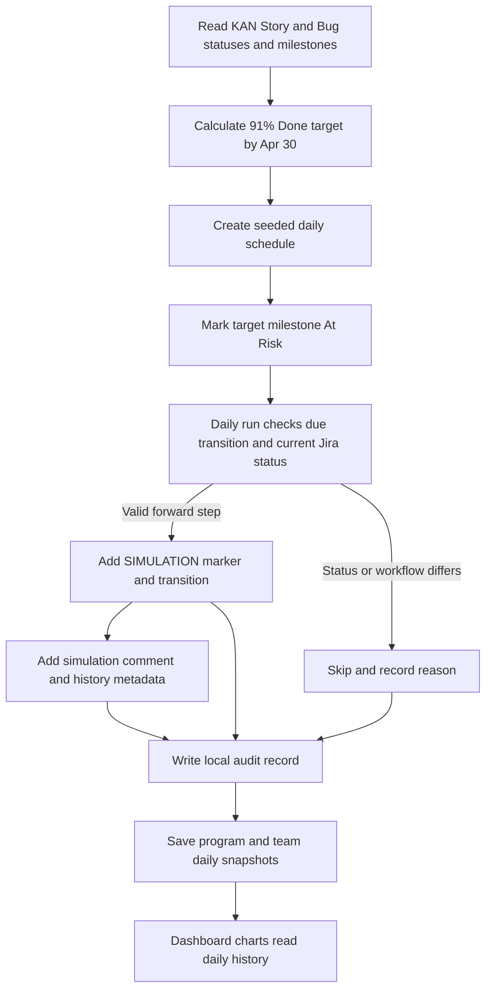

# Jira delivery simulation job

## Scope

Project `KAN` is treated as a simulation project. The scheduled job advances open Jira **Story** and **Bug** issues through the configured forward path `To Do` → `In Progress` → `In Review` → `Done`. Epics, tasks, subtasks, and already-done issues are left unchanged. Already-done Stories and Bugs count toward the overall-scope completion target.

## Schedule and risk scenario

- Runs every calendar day at 4:00 PM Pacific.
- The first planned transition is scheduled for the plan date; there is no artificial startup delay.
- The active milestone remains **At Risk** because reaching 91% Done by April 30 depends on steady daily movement across the remaining scope.
- The plan targets at least **91% of all KAN Stories and Bugs in Done by April 30, 2027**. It counts the live Jira scope and current Done items, then schedules the remaining completions needed to meet the target. Open items beyond the 91% threshold are paced after April 30 through the remaining milestones.
- The schedule is reproducible. Each issue's status transitions are placed on distinct calendar days, and the planner balances movements across days for a gradual flow.
- The job applies no more than five due transitions per daily run and at most one transition per issue in a run, so an issue cannot skip multiple workflow stages in one day.
- After each run, it saves a program-wide daily work snapshot and daily status snapshots for Finance & Accounting, Credit, and Collection. A simulator transition therefore updates daily velocity and team cumulative-flow history without waiting for a dashboard refresh.
- The random seed, issue-to-milestone assignment, planned dates, results, and errors are saved locally. Re-running the job does not reshuffle a saved schedule.

To rebuild the local schedule from current Jira data before any transitions have been applied, run `./.venv/bin/python jira_simulation_job.py --plan-only --replan-to-goal`. It refreshes Stories and Bugs with read-only Jira access, saves a backup of the old plan, schedules the 91% goal, and records today's baseline chart snapshots. It does not write to Jira.



## Jira audit markers

Every applied transition adds the `SIMULATION` label, a `[SIMULATION]` Jira comment, and transition history metadata. Jira records the real execution time; the job never backdates issue history. The local JSONL audit log records the planned date, actual time, status change, and result.

The daily plan reports the number of days with planned movements and the peak number scheduled on one day. The job processes up to five due transitions per run. It checks each issue's current status and the transitions currently offered by Jira before applying a change. It skips issues that no longer match the expected prior status and records the reason.

## Authorization and setup

The Streamlit dashboard stays read-only. The simulation job uses a separate token file and requests `read:jira-work`, `write:jira-work`, and `offline_access`. The Atlassian OAuth app must allow `write:jira-work` and the callback URL `http://localhost:8765/callback`; the Jira user also needs permission to transition issues in KAN. If either is missing, Jira rejects the write.

The simulator runs as its own daily LaunchAgent and is independent of the Friday weekly-readout LaunchAgent. It loads the simulation schedule directly and saves daily chart snapshots itself; it does not depend on a report run or dashboard refresh.

Create or refresh the local schedule for review with:

```sh
cd PT-app
./.venv/bin/python jira_simulation_job.py --plan-only --replan-to-goal
```

This read-only Jira refresh counts Stories and Bugs, calculates the 91% threshold including items already Done, and schedules the remaining issue transitions through April 30, 2027, beginning immediately. It backs up any previous local schedule and changes only local plan files and the risk marker in `milestones.csv`; it does not write to Jira. Review the projected Done count, daily average, and peak transitions in the output. After reviewing the generated plan, authorize the simulator once:

```sh
./.venv/bin/python jira_simulation_job.py --authorize
```

Install `launchd/com.teamvishai.jira-simulation.plist` to apply due transitions automatically every day at 4:00 PM Pacific. This simulator LaunchAgent is independent of the Friday weekly-readout agent; install or run the weekly report only if you want the report draft. The simulator agent uses `--apply`; it starts with the two-week delay recorded in the plan. Logs and the schedule are stored under `data/jira_simulation/`, which is excluded from Git.

## Stop the simulation

Unload the LaunchAgent using the command in `jira_simulation_setup.md`. Jira status changes already applied remain in KAN; pause the job before the next scheduled run if you want to stop further simulation activity.
