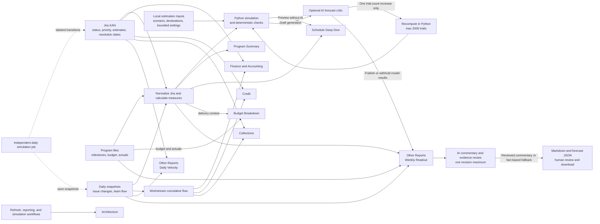

# PT App Project Documentation

**Program dashboard, Jira simulation, and reporting workflow**\
**Project:** Phase 2 transformation program tracker\
**Jira project:** KAN\
**Documentation date:** October 11, 2026

**Google Docs copy:** [PT App Project Documentation](https://docs.google.com/document/d/1DjhMK6DWJXpIkBSt8Smdi-2hCDxiPdl00zzMGTc0BHk/edit?usp=drivesdk)

## Quick overview

PT-app brings Jira delivery, program milestones, and budget evidence into a local dashboard for executives, TPMs, and workstream leads. This document explains the pages, their data sources, the daily and weekly workflows, and the **two bounded agentic loops** used to review forecasts and commentary for the simulated KAN program.

### Sections covered

- **Purpose and value:** use cases, program context, and the latest documented snapshot.
- **Technology:** application libraries, Jira access, AI providers, local files, and scheduled jobs.
- **Dashboard experience:** page responsibilities, priority and effort charts, velocity, and daily change labels.
- **Workflows and architecture:** Jira refresh, independent daily simulation, weekly reporting, and cross-page data flow.
- **Agentic loops:** forecast assumptions and Python model, bounded AI review, real-delivery evidence, and commentary review.
- **Data and implementation:** datasets, replay artifacts, configuration, and project files.
- **Build history and next steps:** prompts, decisions, learnings, current constraints, and follow-up work.

## Use case & value add

PT-app gives executives, TPMs, and workstream leads a shared view of the Phase 2 TD-to-GCP transformation across Finance & Accounting, Credit, and Collections. It combines Jira execution with program milestones, budgets, and recorded actuals so readers can move from a concise program summary to the evidence behind a delivery or funding concern.

| Use case | Value added |
| --- | --- |
| Executive program review | Schedule and cost status, milestone dates, scope, priorities, and effort mix are visible in one summary. |
| Workstream delivery review | Priority exposure, recent completions, resources, technical debt, and linked Jira actions help leads decide what needs attention. |
| Weekly TPM reporting | Fact-based drafts include risks, actions, and a short conditional forecast, with bounded AI review and a usable fallback. |
| Scenario demonstration | Independent daily simulation builds repeatable Jira activity and trends; effort-based forecasts explore the confirmed assumptions for the simulated program. |

## Technology stack

| Layer | Technology used |
| --- | --- |
| Runtime | Python; README recommends Python 3.10 or later. The currently verified local virtual environment uses Python 3.9.6. |
| Dashboard and charts | Streamlit `>=1.40` and Plotly `>=5.20` for pages, controls, metrics, tables, and interactive charts. |
| Data preparation | pandas `>=2.0` for Jira normalization, aggregation, snapshots, and schedule/budget analysis. |
| HTTP and configuration | requests `>=2.32` for service calls and toml `>=0.10` for TOML configuration. These are declared minimum dependency versions. |
| Jira integration | Jira Cloud REST API v3 with OAuth 2.0 authorization-code access and token refresh; dashboard/report access and the daily simulation write path are configured separately. |
| AI review and commentary | Local Ollama with `llama3.2` by default; optional OpenAI Responses API. The configured provider serves the forecast critic and separate commentary drafting/review loop. Python owns calculations and forecast dates. |
| Local files | CSV for program inputs and snapshots; JSON for settings, state, and forecast replay; JSONL for simulation audit; Markdown for documentation and readouts; TOML for application configuration. Credentials remain in ignored local configuration/token files. |
| Scheduled automation | macOS `launchd` LaunchAgents and `.plist` definitions for independent daily simulation and weekly readout jobs. |

## Project overview

PT-app is a local Streamlit application for tracking the Phase 2 transformation program that moves user groups from TD to GCP. It brings Jira delivery data and local schedule and budget files into one dashboard for executives, workstream leads, and program reviewers. The dashboard covers Finance & Accounting, Credit, and Collections, while a separate Jira simulation job creates a controlled delivery scenario for project KAN.

The application separates calculated facts, conditional simulation outputs, and generated narrative. Python derives scope, status, schedule, cost, and velocity measures from Jira and local files and runs a bounded simulated milestone model. Weekly draft generation checks the model results deterministically, optionally asks an AI critic to review the evidence, and permits one trial-count increase. A separate AI loop drafts executive commentary, checks its evidence and risk coverage, and can revise it once. Rejected forecasts are withheld; commentary failures retain the fact-based report. The readout loop does not edit Jira. Jira writes are handled only by the separately configured simulation job.

The milestone file spans September 2026 through October 2027, with overlapping workstreams. KAN is fully simulated. The agreed Unit testing target, scope-growth assumptions, model method, and evidence requirements are grouped under **Agentic loops → Loop 1** below.

In the latest verified saved Jira readout on October 11, 2026, the issue set contained 320 open and 15 completed Stories and Bugs, totaling 335 items. The draft showed Overall as RED, Schedule as GREEN, and Cost as RED. These values describe that saved snapshot and its calculated status; the conditional forecast's timing risk is reported separately.

## What the dashboard contains

| Page | Purpose |
| --- | --- |
| Program Summary | Executive schedule and budget status, milestone timeline, Jira scope, open-versus-done view, and team-size context. Schedule overview includes a status-by-priority item-count chart and a Complexity/Effort pie counting Stories by their story-point estimate. |
| Schedule Deep Dive | Milestone detail, item pace, open priority breakdown, weekly completions, effort evidence, conditional simulated Unit testing forecasts with assumptions and diagnostics, real-delivery readiness, and daily trends. |
| Budget Breakdown | Planned allocations, recorded actuals, spent and remaining amounts, and comparable variances, with compact priority and completion context. |
| Finance & Accounting | Jira work filtered to the Finance & Accounting epic and team component, including backlog, technical debt, bugs, status, open priority, weekly completions, high-priority action links, and resources. |
| Credit | The same delivery and resource views scoped to the Credit epic and team component. |
| Collections | The same delivery and resource views scoped to the Collections epic and team component. |
| Architecture | Shared data-source and automation diagrams, with a reference for priority, completion counts, effort estimates, and milestone evidence requirements. |
| Other Reports | Weekly readout with a compact earliest/latest forecast summary and brief assumptions, bounded forecast review, executive commentary review, and saved replay artifacts; Daily Velocity with priorities, weekly completions, daily status trends, issue comparisons, and priority changes. |

The Jira team field distinguishes the workstreams. The `platform readiness` component is treated as technical debt; Finance & Accounting, Credit, and Collection items are shown as workstream backlog. The configured epic keys are KAN-6 for Finance & Accounting, KAN-8 for Credit, and KAN-7 for Collections.

### Priority, effort, and velocity enhancements

**Executive view.** At the end of Program Summary's **Schedule overview**, the status-by-priority stacked bar chart counts current Stories and Bugs, including completed items, and prints the total item count above each priority bar. Status colors distinguish To do, In progress, Done, and Other. Blank priorities appear as **Unspecified**. Beside it, the **Complexity/Effort view** pie groups Stories, including completed Stories, by each distinct story-point estimate. Slice labels show the estimate and Story count; hover text also shows the percentage. Each slice counts Stories rather than summing points. Bugs are excluded from this pie. Missing or invalid estimates appear in a **Not estimated** slice, while zero remains a valid estimate. Jira's story-point fields are discovered during refresh.

**Delivery views across pages.** Detailed views show High-priority open items, High-priority overdue items, Completed in last 7 days with a comparison against the prior seven days, and Open backlog. Tooltips explain each measure. They pair open items by priority and status with four weekly completion bars, then provide a linked high-priority action list ordered by Highest priority, overdue status, and earliest due date.

| Page | Priority and velocity placement |
| --- | --- |
| Program Summary | The two executive charts finish Schedule overview; full velocity and priority action lists remain in the detailed pages. |
| Schedule Deep Dive | Program-wide priority exposure, open backlog, recent completions, four weekly completion windows, and high-priority Jira action links, alongside the full effort outlook and forecast. |
| Finance & Accounting, Credit, Collections | The same detailed delivery views filtered to the page's workstream backlog and epic-linked technical debt, plus existing resources and cumulative-flow charts. |
| Budget Breakdown | Compact program-wide delivery context: High-priority open items, High-priority overdue items, and Completed in last 7 days. Priority and pace do not determine actual spend or cost variance. |
| Other Reports → Weekly Program Readout | A Current priority and delivery context expander holds the three compact measures and the short forecast summary. Saved drafts retain their original reporting date; the expander reflects the current refresh. |
| Other Reports → Daily Velocity | Current status counts, detailed priority/completion views, daily issue changes, a separate priority-change list, and daily backlog trends. |
| Architecture | A Priority and velocity across pages reference explains shared sources and the difference between priority exposure, completion counts, effort, and forecast evidence. |

**How completion pace is counted.** These measures count Stories and Bugs in the current page scope. High priority means Jira **High** or **Highest**. An open item is overdue when its Jira due date is before the Pacific calendar date of the last successful refresh; items without due dates are excluded from overdue counts. Weekly bars count currently Done items by their Jira resolution timestamp in four consecutive trailing seven-day windows ending at that refresh, with the exact window displayed. Boundary timestamps belong to only one window. Status movements alone are not completions, and a point estimate is not an item count. Team views use current page membership rather than reconstructing team ownership when work was completed.

Missing completion dates are disclosed, and partial coverage counts only known dates. When usable completion timing is unavailable, the page says **Unavailable** rather than zero. A known window with no completions shows zero. The Schedule Deep Dive milestone outlook separately shows known remaining Story/Bug points, estimate coverage and unestimated counts, remaining estimates by workstream, and completed points over the last four weeks. Weekly Readout keeps only a compact forecast summary. Story points represent relative effort, can use different scales across teams, and cannot be converted into days by simple division.

**Daily change labels and tooltips.** The selected Snapshot day is compared with the previous recorded day, which may not be the preceding calendar day. Each changed issue belongs to one of these four categories; the hover help makes their meaning explicit.

| Display label | Meaning |
| --- | --- |
| Status movements | Existing issues whose status changed. Each issue counts once even if other fields also changed. |
| Added to snapshot | Issues newly included in the tracked scope: either new Jira issues or existing issues absent from the earlier snapshot. Moving an existing issue to In Progress does not count as an addition. |
| Field updates | Existing issues whose assignee, priority, team, summary, or issue type changed while status stayed the same. If status also changed, the issue counts under Status movements instead. |
| Missing from snapshot | Previously tracked issues absent from the selected snapshot; absence does not establish deletion. |

The **Priority changes on this day** list includes net priority changes even when the same issue also changed status. Issue rows include Jira links, current status, owner, priority, team, and changed fields. These comparisons are actor-neutral net differences between saved snapshots, not a complete Jira event log; changes made and reversed between snapshots can be invisible. The first issue snapshot is a baseline. The daily status trend defaults to the latest ten calendar days, allows another range, leaves gaps for days with no snapshot, and compares net counts with the previous recorded snapshot.

## Main workflows

| Workflow | Steps | Result |
| --- | --- | --- |
| Daily refresh | A dashboard refresh or the independent simulation job fetches KAN issues, normalizes issue fields, and saves current counts, team status counts, and issue-level state. The dashboard checks snapshot files while open and refreshes after a new snapshot appears. | Current Jira views, daily status trends, and a comparison of each saved issue snapshot with the previous recorded day. |
| Weekly readout | Python simulates the confirmed milestone cases and validates their output. An optional AI critic can request one bounded trial-count rerun. The report summarizes earliest/latest model dates and brief assumptions alongside core program status, budget, milestones, risks, and actions, then separately reviews AI commentary with one revision allowed. | A concise local Markdown draft plus the full `.forecast.json` replay artifact. A note directs readers to Schedule Deep Dive for detail. Model dates remain conditional and simulated, the permitted unfinished portion is a schedule risk, and fact-based reporting survives forecast rejection or commentary failure. |
| Delivery simulation | A separate scheduled job reads a planned transition schedule, applies due forward Jira transitions to KAN using a dedicated write-enabled OAuth app, labels simulation activity, and records audit information. It then saves refreshed snapshots. | A repeatable simulated delivery history that feeds the dashboard's velocity and flow charts. It operates independently from the weekly readout job. |

The daily and weekly workflows have different purposes. The daily job builds a changing Jira scenario and dashboard history. The weekly job summarizes available facts and drafts a report; it does not wait for, trigger, or update Jira through the simulation job.

### How data flows across dashboard pages

The tabs are independent views over shared sources, so users can open the page they need. Jira KAN supplies the live issue and workstream views. Local milestone, budget, and actuals files feed schedule and cost analysis. Daily snapshots power the history views. The delivery simulator is the only automated write path and records its own labeled Jira transitions and snapshots. All resulting facts are consumed by the pages shown below.

This diagram describes the current data dependencies. Architecture is a workflow reference page. Daily Velocity displays current Jira status and net differences between saved issue snapshots. Python owns forecast calculations; the optional forecast critic can request only one trial-count rerun. Weekly commentary then undergoes its separate bounded evidence review. Page previews skip AI, and model rejection preserves the fact-based report.

## Agentic loops

PT-app has **exactly two bounded agentic loops**, invoked during weekly draft generation. Python supplies calculations and deterministic checks; AI reviews the evidence or narrative. Ordinary page previews use cached Python without AI and are labeled unreviewed. One configured provider/model can fill the different drafting and reviewer roles.

| Loop | Permitted feedback | Maximum per draft |
| --- | --- | --- |
| **1. Forecast evidence review and recomputation** | Approve, reject, or request one increase in simulation trials. | **Two critic calls and two Python runs**: initial computation plus one rerun. |
| **2. Weekly commentary draft, review, and revision** | Request one revised narrative to address evidence or risk gaps. | **Two review passes, one revision, four AI calls**: draft → review → revise → review. |

With forecasting enabled and first-pass approvals, the usual total is **three AI calls**; the combined maximum is **six AI calls**. Python modeling supports Loop 1. Daily simulation, schedules, dashboard calculations, and real-delivery evidence checks are supporting processes, not additional loops.

### Loop 1: Forecast evidence review and recomputation

**Flow:** Python simulation → deterministic checks → AI critic → optional Python rerun → deterministic checks → final critic review. A critic may request double the trials, capped at 2,000, once. The rerun preserves the seed, source facts, growth settings, and business assumptions. No rerun is allowed at the cap, and AI cannot edit forecast dates.

Failed deterministic checks or a critic rejection withhold model dates while retaining the fact-based report. An unavailable critic preserves valid Python results explicitly labeled **unreviewed**. Approval checks consistency with supplied evidence; it does not establish future delivery accuracy.

#### Confirmed milestone scenario

- **Scope and target:** all KAN Stories and Bugs, including technical debt, counted once; at least **91% Done by item count**, rounded up. The permitted **up to 9% unfinished** is an explicit weekly schedule risk with actions, not an actual residual percentage or probability.
- **Owner and dates:** TPM owns the scenario. Unit testing validation is planned from **February 1 to April 30, 2027**. Done is final for this stage; UAT, business acceptance, and overall program closure are downstream and excluded.
- **Teams and remaining work:** unchanged teams work independently at **100% program allocation**, keeping their own point scales. Done has zero remaining effort; every not-Done item retains its full valid recorded points, including work already in progress.
- **Inventory growth:** further Stories can arrive through **October 30, 2026**; quantity and effort mix are unknown. The existing **100 Stories KAN-244–KAN-343 are already counted**. Current-scope required counts and pace exclude unknown future arrivals and remain provisional.
- **Baseline confirmation:** after October 30, modeled future additions become zero, but the TPM must still confirm inventory closure. The CSV Inventory completion deadline is **October 31**, distinct from the growth cutoff; a visible, nonblocking alignment note preserves both dates.

#### Python model and conditional dates

Python completes whole items within parallel workstream queues using these simulated assumptions:

- **Capacity:** lognormal weekly effort budgets, with assumed coefficient of variation `0.35`, use known points on currently Done items resolved in the last seven days. Without positive completed-point evidence, assume **8 relative points per assigned contributor per week**, or one contributor when no named assignee exists. These inputs do not independently verify available capacity.
- **Unknown estimates:** missing open estimates use the workstream's positive-estimate upper quartile only inside the model. Source fields and coverage remain unknown. A workstream without a usable point scale cannot run.
- **Cases:** **400 trials per case**, seed `20261011`, **156-week horizon**. Growth of **0%, 10%, and 25%** crosses priority-then-larger-items-first (primary) and priority-then-smaller-items-first (sensitivity): six assumed cases within the same model, not six loops or likely-arrival predictions.
- **Arrivals and timing:** future Stories sample current workstream, priority, and effort mix and arrive through the cutoff. Backlog work can progress earlier, but modeled target attainment cannot precede the latest of the observation date, the inventory cutoff while open, and the Unit testing planned start.
- **Outputs:** 10%, 50%, and 90% model dates, the fraction of trials meeting April 30, and unfinished trials. All are conditional simulated outcomes, not calibrated confidence or real-world probabilities. Unfinished trials remain in the denominator; percentiles beyond the horizon are unavailable. The horizon must extend through the deadline or the run is unavailable.

#### What readers see

**Schedule Deep Dive** holds full scenarios, effort/history, evidence, assumptions, and diagnostics. **Weekly Readout** keeps earliest/latest modeled completion dates, brief assumptions, and a note directing readers to that page; detailed tables, trial fractions, and readiness checks stay out of the weekly Markdown.

The weekly earliest date is the **minimum 10% model date across cases (P10)**; the latest is the **maximum 90% model date (P90)**. This early-to-conservative range is conditional, not a guaranteed first or last completion date. If any case's P90 is censored beyond the horizon, the latest date remains unavailable. A primary median later than April 30 adds a timing lowlight and follow-up action, separate from the milestone's calendar-derived status.

Each draft's downloadable `.forecast.json` retains normalized replay inputs, version/seed, fingerprints, run ID, assumptions, and review diagnostics, excluding raw Jira descriptions and credential objects. [`weekly_readout_setup.md`](weekly_readout_setup.md) explains replay.

#### Real-delivery evidence and configuration

Schedule Deep Dive's **Real-delivery evidence gaps** assessment checks ten inputs: scope/target, point coverage, history, provenance, milestone scope/acceptance, dependencies, capacity/leave, remaining work, testing/rework, and validation. It shows evidence, owners, and next actions, calculates no date, and does not block the simulated forecast. **Ready for model setup** means these blockers are cleared.

Representative history requires Done resolution dates spanning **28 days**, positive estimated completions in the last 28 days, and owner confirmation. KAN defaults to simulation; other projects default to unknown. Simulation labels block real readiness despite declarations. Simulation history and critic approval do not establish actual capacity or accuracy; real use requires empirical backtesting/calibration and reviewed delivery evidence.

Approved scenario declarations and bounded settings live in ignored `data/estimation_inputs.json`. The example remains disabled with confirmations false; the local KAN file enables this demonstration. Declarations are not independently verified. Invalid settings or a mismatched project discard declarations and retain safe defaults; missing files leave them unconfirmed. Schema, confirmation keys, and setting bounds are documented in [`README.md`](README.md) and [`estimation_inputs.example.json`](estimation_inputs.example.json).

### Loop 2: Weekly commentary draft, review, and revision

**Flow:** draft → evidence/risk review → optional revision → second review. From the fact-based report, the configured model returns a structured status line, a short summary, and **one to five bullets**. Python rejects extra section headings or Markdown tables, preventing repeated report sections, and enforces source facts, exact statuses, dates, and output structure. The reviewer checks evidence, status, risk, and action coverage.

One revision is permitted. A second failed review, invalid output, or provider error keeps the fact-based report with a warning. Commentary failure does not invalidate accepted Python forecasts. AI does not calculate metrics, edit dates, or perform Jira actions. Local Ollama/`llama3.2` is the default; optional OpenAI uses ignored `.streamlit/secrets.toml` configuration.

## Datasets and sources

| Dataset | Important fields or contents | How PT-app uses it |
| --- | --- | --- |
| Jira project KAN | Issue key, summary, type, workflow status, assignee, priority, team field, epic, due date, update and resolution dates, discovered story-point fields | Live source for backlog, team, priority, status, velocity, and delivery evidence. Weekly completion charts count Stories and Bugs as items. The Program Summary Complexity/Effort pie counts Stories grouped by estimate; the milestone outlook reports known remaining and recently completed points with coverage and workstream detail. |
| `milestones.csv` | Milestone, start date, due date, and source status | Defines the overlapping schedule, including Inventory completion on October 31, 2026 and Unit testing validation on April 30, 2027. The October 30 scenario growth cutoff remains separate and an alignment note flags the difference. The weekly readout derives a display state from dates when the CSV says Not started, while retaining explicit states such as At Risk or Complete. |
| `program_budget.csv` | Budget bucket, component, resource count, coverage, planned allocation, and share | Provides planned program funding and component allocation. The current file totals $12 million against a $10 million cap, so the dashboard flags a $2 million planning gap. |
| `program_actuals.csv` | Month, component, actual amount, and basis | Records monthly actuals supplied locally. The September 2026 rows total $188,502: $180,822 for the partner invoice, $7,680 for two in-house resources, and $0 for technical resources/platform support. |
| `executive_summary.md` | Program context and highlights | Supplies narrative context for the Program Summary page. |
| `data/weekly_work_snapshots.csv` | Snapshot date, open item count, completed item count | Stores daily aggregate Story and Bug counts. The filename is retained for compatibility although the rows now represent daily points. |
| `data/daily_team_flow_snapshots.csv` | Snapshot date, team, status category, item count | Feeds workstream cumulative-flow and daily status charts. |
| `data/daily_issue_status_snapshots.csv` | Daily issue key, summary, type, team, status, assignee, priority, update time, and link | Stores issue-level snapshots so Daily Velocity can show net per-issue changes between recorded days. The detailed history begins with the first issue-level snapshot; older aggregate counts cannot be backfilled to specific issues. |
| `data/jira_simulation/schedule.json` and `audit.jsonl` | Planned issue transitions and run records | Preserve the simulation plan and applied transition audit. Generated runtime data and local OAuth tokens are kept out of source control. |
| `data/estimation_inputs.json` | Optional project-specific data mode, owner declarations, milestone scenario, and bounded forecast settings | Records the simulated target, growth cutoff, owner assumptions, enablement, seed, trial count, and sensitivities. It cannot override simulation provenance or independently verify evidence; runtime data is ignored by Git. |
| `data/weekly_readouts/*.forecast.json` | Saved model results, normalized replay inputs, fingerprints, assumptions, and validation/review diagnostics | Companions to Markdown readouts support downloads and reproducible Python runs without raw Jira descriptions or OAuth/model credential objects. |

The Jira and budget observations above are dated to this October 11, 2026 documentation snapshot. Live Jira views and local program files can change afterward. Actual spend is recorded in CSV; it is not inferred from Jira. Team membership is estimated from distinct Jira assignees and depends on the assignee data returned by Jira.

## Prompts used during vibe coding

The following excerpts represent the main prompts that shaped the application. They are selected examples from the build conversation, not an exhaustive prompt transcript.

| Prompt excerpt | Direction it gave the build |
| --- | --- |
| “The program dashboard with multiple tabs. The first page would be more like a summary… Followed by second, third and fourth page should have details of finance accounting, Credit and Collections.” | Established an executive landing page and separate workstream views. |
| “use team field to differentiate between tech debt items and backlog items” and “correct platform readiness is tech debt” | Defined how the Jira team field and platform-readiness component should classify work. |
| “There is too much information in Executive summary… what should be most important information for executive and how can we distill rest of information to other pages?” | Led to a shorter Program Summary and moved delivery detail into Schedule Deep Dive and Other Reports. |
| “Can you also suggest what would be best way to bring up overall budget breakdown for the transformation program… overall budget 10mil” | Added a program budget model, broader budget buckets, actual spend, and cap comparison. |
| “the simulation schedule should run independent of weekly scheduled job” | Separated the daily Jira simulation from weekly report generation. |
| “By April 30 we should move at least 91% of backlog to done against KAN project. So we can kick start the UAT phase.” | Set the simulation completion target and its date. |
| “Daily velocity should reflect current status of backlog to any user it should be agnostic who has done.” | Kept the velocity view actor-neutral and focused on backlog state. |
| “please show daily snapshot trend over time for last 10 days” | Added a recent daily trend window and snapshot-count visualization. |
| “Can you bring in agentic looping within that weekly readout to make sure we are covering all the aspects and calling out the risks appropriately?” | Added a bounded draft, evidence review, and one-revision loop with deterministic fallback. |
| “In the daily velocity can you provide a snapshot what changes were done in a day?” | Added issue-level snapshots and a day-by-day net change list. |

## Iterations and decisions

1. **Defined the product shape.** The first design placed executive summary, schedule, budget, and three team views in one Streamlit dashboard. The dashboard was then organized around a concise Program Summary, with deeper schedule, budget, team, and report details on separate pages.
2. **Clarified Jira semantics.** The Jira team field became the workstream classifier. Platform readiness was explicitly designated as technical debt, which prevented it from being combined with Finance, Credit, or Collections backlog.
3. **Refined the executive view.** The Program Summary was reduced to overall schedule and cost status, highlights and lowlights, the milestone timeline, concise scope and team size, and a simple open-versus-done view. Weekly velocity and work-category detail moved to Schedule Deep Dive and Other Reports.
4. **Added budget planning and actuals.** The program budget was grouped into implementation partner, in-house resources, compute and platform support, and contingency. `program_actuals.csv` was introduced for recorded spend. The dashboard now distinguishes the $10 million cap from $12 million of current planned allocations and reports the difference.
5. **Separated daily simulation from weekly reporting.** The Jira simulator became an independent daily job with a dedicated OAuth path, a planned transition schedule, simulation labels, and audit data. The readout job remains a separate report-only process.
6. **Built daily velocity in stages.** The page began with current status counts, then gained a 10-day trend and net status movement. Because aggregate counts could not say which Jira keys moved, issue-level snapshots were added to identify status, scope, team, assignee, priority, type, and summary changes between snapshots.
7. **Added guarded AI commentary.** The weekly report keeps deterministic metrics and evidence. The configured model can draft commentary, undergo an evidence and risk coverage review, and revise once. Missing, ambiguous, or unsupported commentary falls back to the fact-based report. A date-formatting issue with missing Jira due dates was also corrected so a null date does not crash the report.
8. **Implemented bounded simulated estimation.** Effort remains within workstreams while the milestone target remains an item count. Scope-growth and selection-policy sensitivities produce conditional dates, preserve horizon-censored trials, and disclose fallback capacity and estimate assumptions. Deterministic checks and an optional AI critic protect published results; a single permitted trial-count rerun and saved replay inputs make the review bounded and auditable. Real-delivery readiness remains separate.

## Learnings and observations

- **Define data meaning before building charts.** Jira counts represent issues, not effort or story points. The team field and the `platform readiness` classification had to be settled before the backlog visuals could be trusted.
- **Aggregate snapshots answer a different question from issue history.** Open and completed totals show whether the backlog mix changed. They do not identify which issues moved. The new issue-level snapshot provides that detail going forward.
- **A daily comparison shows net change, not every Jira event.** If an issue changes status and returns to its previous status between two saved snapshots, the difference view will not show the intermediate movement. Exact event history requires Jira changelog data or the simulator audit.
- **Separate source facts from display logic.** `milestones.csv` remains the source of planned dates and explicit status, while the weekly readout derives Upcoming, In Progress, or Overdue when a source row still says Not started. This keeps the file intact while making the readout reflect the calendar.
- **Budget status depends on comparable inputs.** The current plan is $12 million against a $10 million cap. Actuals are supplied by month and component. A period variance should be calculated only when a comparable plan value exists; the model should not invent one.
- **AI narrative needs visible evidence checks and a safe fallback.** The model supports concise interpretation, but Python remains the source of metrics and status. Reviewer feedback must be surfaced when commentary fails, and the deterministic report remains available.
- **Simulation must remain clearly labeled.** KAN is the simulation project. The daily transition job is distinct from read-only dashboard access and weekly reporting. The result should be treated as simulated program activity, not production migration evidence.

## Current constraints and next steps

Daily issue-level change history begins when the first snapshot is saved and cannot reconstruct item-level activity from earlier aggregate CSV snapshots. The change list reports the net difference between recorded snapshots, not a complete Jira event log. Program actuals are maintained in `program_actuals.csv`, so component-level reporting depends on that file being updated with comparable amounts and an explicit basis.

The simulated model does not independently model leave calendars, skill constraints, cross-team dependencies, UAT, reopening, or business closure. Its last-seven-day simulated effort and assumed fallback are not measured real capacity; the growth cases and capacity variation are assumed sensitivities. Real delivery use requires empirical backtesting/calibration, representative history, reviewed remaining effort and dependencies, and acceptance evidence. Deterministic output checks and AI approval do not replace that work.

The next useful steps are to quantify further inventory arrivals, have the TPM confirm the baseline after the growth cutoff, reconcile the October 30 cutoff with the October 31 Inventory milestone, and plan real-model calibration. Budget work still includes reconciling $12 million planned allocations with the $10 million cap, adding comparable monthly plans, and keeping actuals current. Weekly drafts and their model diagnostics need human review before sharing.

## Project files

- Application: `app.py`
- Jira data preparation and snapshots: `jira_dashboard/data.py`
- Weekly readout and model review: `jira_dashboard/readout.py`
- Simulated milestone engine: `jira_dashboard/forecast.py`
- Bounded model checks and critic: `jira_dashboard/forecast_review.py`
- Forecast panels and replay artifacts: `jira_dashboard/forecast_views.py`, `jira_dashboard/forecast_artifacts.py`
- Compact weekly forecast summary: `jira_dashboard/forecast_summary.py`
- Google Docs data-flow diagram source: `docs/diagrams/dashboard_data_flow.svg`
- Real-delivery readiness and local inputs: `jira_dashboard/readiness.py`, `jira_dashboard/readiness_inputs.py`
- Daily simulation job: `jira_simulation_job.py`
- Milestone plan: `milestones.csv`
- Planned budget: `program_budget.csv`
- Recorded actuals: `program_actuals.csv`
- Project usage and workflow notes: `README.md`
